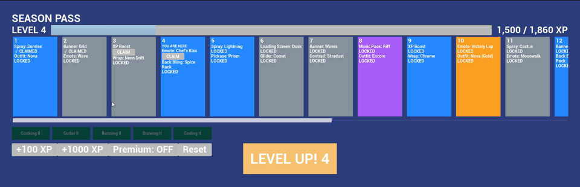
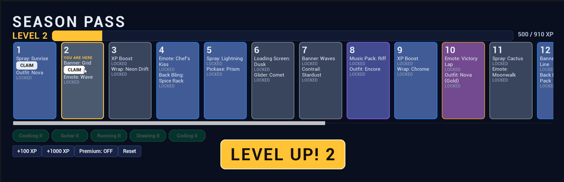

# Season Pass UI: Unreal Engine 5 · C++ · UMG · MVVM


▶ **[Watch the full demo (48 s)](https://youtu.be/X8nqCj49jE0)**

A Fortnite-style season progression screen built in **Unreal Engine 5.8**. It has 20 reward tiers with free and premium tracks, an XP bar that fills smoothly, claimable rewards, an animated level-up toast, a tier list that scrolls to follow your level, skill nodes that unlock as you claim tiers, and progress that is saved between sessions.

The point of the project is the **architecture**. All rules live in C++. Widgets bind to a ViewModel through UMG Viewmodel (MVVM) and contain no game logic. **31 automation tests** cover the Model and the ViewModel.

---

## Architecture

```
DT_SeasonTiers (DataTable, FSeasonTierRow)        ← content, imported from CSV
        │
        ▼
USeasonProgressSubsystem   ← MODEL: state, rules, events, save/load. Knows nothing about UI.
        │  OnProgressChanged / OnLevelUp / OnTierClaimed
        ▼
USeasonPassViewModel       ← VIEWMODEL: display-ready FieldNotify properties
  ├─ USeasonTierViewModel × 20     (one per tile)
  └─ USkillNodeViewModel  × 5      (skill chips)
        │  MVVM View Bindings (declarative, no Blueprint graph logic)
        ▼
WBP_SeasonPass → ListViews of WBP_TierTile and WBP_SkillChip, XP bar, level-up toast, debug buttons
```

| Layer | Class | Responsibility |
|---|---|---|
| Data | [`FSeasonTierRow`](Source/SeasonPassUI/Model/SeasonTypes.h) | XP thresholds, rewards, rarity and skill unlock for each tier |
| Model | [`USeasonProgressSubsystem`](Source/SeasonPassUI/Model/SeasonProgressSubsystem.h) | XP and level math, claim rules, premium gating, skill unlocks; broadcasts events |
| Persistence | [`USeasonSaveGame`](Source/SeasonPassUI/Model/SeasonSaveGame.h) | Saved after every change, loaded at startup |
| ViewModel | [`USeasonPassViewModel`](Source/SeasonPassUI/ViewModel/SeasonPassViewModel.h), [`USeasonTierViewModel`](Source/SeasonPassUI/ViewModel/SeasonTierViewModel.h), [`USkillNodeViewModel`](Source/SeasonPassUI/ViewModel/SkillNodeViewModel.h) | Turns model state into bindable values (`LevelLabel`, `bFreeClaimable`, `RarityColor`…) and forwards user intents back |
| View | [`USeasonPassWidget`](Source/SeasonPassUI/UI/SeasonPassWidget.h), [`USeasonTierTileWidget`](Source/SeasonPassUI/UI/SeasonTierTileWidget.h), [`USkillChipWidget`](Source/SeasonPassUI/UI/SkillChipWidget.h), [`SeasonPassStyle.h`](Source/SeasonPassUI/UI/SeasonPassStyle.h) | Fills ListViews, plays the toast, eases the XP bar, auto-scrolls, and applies the visual style |
| Composition | [`ASeasonPassHUD`](Source/SeasonPassUI/UI/SeasonPassHUD.h) | Wires Model → ViewModel → View at `BeginPlay` |

## Why MVVM

Game UI changes constantly: layouts get redesigned, art passes land, and new platforms need different input. The rules behind the UI, like "can this reward be claimed?", should not have to change with it.

- **The rules live in one place.** The subsystem decides what's claimable. The widget never computes it, so there's no duplicate logic to drift out of sync.
- **The widgets are replaceable.** The section below shows this happening.
- **Data flows one way.** ViewModel properties are `BlueprintReadOnly`, so a widget can't write state. It can only call intent functions like `ClaimFree()` or `DebugAddXP()`, and the result flows back through FieldNotify.
- **Both logic layers are testable without UI.** The Model and ViewModel have no widget dependencies, so they're covered by automation tests that run headless.
- **Updates are event-driven, not polled.** FieldNotify broadcasts only the values that changed (there's a test for that), and bindings update only the widgets that depend on them.

## Same ViewModel, two Views

| Before: functional first pass | After: C++ style pass |
|---|---|
|  |  |

The visual pass added rounded rarity tiles, a gold current-tier highlight, a styled XP bar, buttons and toast, pill-shaped skill chips and auto-scroll. **It changed only the View layer:**

```
Source/SeasonPassUI/UI/*            7 files   +412 / −5
Content/UI/WBP_TierTile, WBP_SkillChip   (reparented to the styled C++ classes)
Source/SeasonPassUI/Model/          0 changes
Source/SeasonPassUI/ViewModel/      0 changes
Source/SeasonPassUI/Tests/          0 changes, all 31 still pass
```

One detail worth calling out: the tile used to bind `RarityColor` straight to a border's color. Now it binds to view functions on the tile (`SetRarityColor`, `SetIsCurrentTier`). The ViewModel still only says *"this tier is Epic and current"*, and the View decides what that looks like.

## Tests

**31 automation tests** in two specs:

[`SeasonProgressSpec.cpp`](Source/SeasonPassUI/Tests/SeasonProgressSpec.cpp), `SeasonPass.Progress` (Model, 16 tests):
- Level math at XP boundaries (499 vs 500 XP), the max-level cap, and rejection of non-positive XP
- A multi-level XP jump broadcasts a single level-up with the final level
- Locked tiers can't be claimed, premium needs premium, and nothing can be claimed twice
- Free and premium claims are tracked independently, and claiming unlocks skill nodes
- Reset clears all state; save data round-trips and notifies listeners on load

[`SeasonPassViewModelSpec.cpp`](Source/SeasonPassUI/Tests/SeasonPassViewModelSpec.cpp), `SeasonPass.ViewModel` (ViewModel, 15 tests):
- One tier ViewModel per tier and one skill ViewModel per skill node
- Display-ready labels (`LEVEL 3`, `1,000 / 1,500 XP`, `MAX`, `Premium: ON`)
- Exactly one of locked / claimable / claimed per track, and only the current tier marked
- Claims and debug intents are forwarded to the model and reflected back
- The level-up toast shows, dismisses, and re-triggers when leveling again while visible
- **FieldNotify only fires for fields whose values changed**

The tests inject tier data directly, so they don't depend on any `.uasset`. Persistence is tested through `WriteTo`/`ReadFrom`, so no test touches the disk.

## Running it

**Requirements:** Unreal Engine 5.8, Visual Studio 2022+ with the "Game development with C++" workload, and Git LFS.

```bash
git lfs install
git clone https://github.com/Neo-Land/season-pass-ui.git
```

1. Right-click `SeasonPassUI.uproject` → **Generate Visual Studio project files**, then build **Development Editor / Win64**.
2. Open the project and press **Play**.
3. Use the debug buttons: **+100 XP**, **+1000 XP**, **Premium** toggle and **Reset**. Progress is saved, so it carries over to the next Play session.

**Running the tests:**
- **In the editor:** Tools → Session Frontend → Automation, filter `SeasonPass`, then Start.
- **From the command line:**
  ```bash
  UnrealEditor-Cmd.exe SeasonPassUI.uproject -ExecCmds="Automation RunTests SeasonPass;Quit" -unattended -nullrhi
  ```

## Project layout

```
Source/SeasonPassUI/
├─ Model/       SeasonTypes.h, SeasonProgressSubsystem, SeasonSaveGame
├─ ViewModel/   SeasonPassViewModel, SeasonTierViewModel, SkillNodeViewModel
├─ UI/          SeasonPassWidget, SeasonTierTileWidget, SkillChipWidget, SeasonListEntryWidget,
│               SeasonPassStyle.h, SeasonPassHUD
└─ Tests/       SeasonProgressSpec, SeasonPassViewModelSpec, SeasonTestData.h
Content/
├─ Data/        SeasonTiers.csv → DT_SeasonTiers
├─ UI/          WBP_SeasonPass, WBP_TierTile, WBP_SkillChip
└─ Maps/        L_SeasonPass
```

## What's next

- **CommonUI** for gamepad and keyboard focus and input routing, the way Fortnite's menus handle it
- **Material-driven effects**: a shimmer on claimable tiles and a gradient XP fill
- **Claim feedback**: a reward pop animation and sound cues
- **Localization**: all display text already goes through `FText`/`LOCTEXT`, so string tables are the next step

## Out of scope

There's no networking, no real purchases and no custom art: everything is drawn with Slate rounded boxes and engine fonts. The skill-node tie-in connects to my project Gamify.Life.
