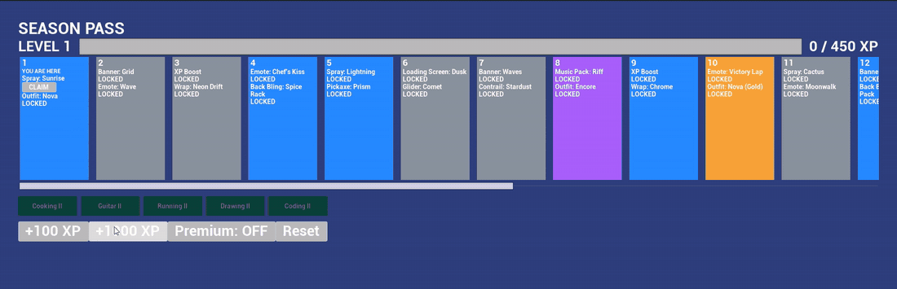

# Season Pass UI: Unreal Engine 5 · C++ · UMG · MVVM



A Fortnite-style season progression screen built in **Unreal Engine 5.8**. It has 20 reward tiers with free and premium tracks, an XP bar that fills smoothly, claimable rewards, an animated level-up toast, and skill nodes that unlock as you claim tiers.

The point of the project is the **architecture**. All rules live in C++. Widgets bind to a ViewModel through UMG Viewmodel (MVVM) and contain no game logic.

---

## Architecture

```
DT_SeasonTiers (DataTable, FSeasonTierRow)        ← content, imported from CSV
        │
        ▼
USeasonProgressSubsystem   ← MODEL: state, rules, events. Knows nothing about UI.
        │  OnProgressChanged / OnLevelUp / OnTierClaimed
        ▼
USeasonPassViewModel       ← VIEWMODEL: display-ready FieldNotify properties
  ├─ USeasonTierViewModel × 20     (one per tile)
  └─ USkillNodeViewModel  × 5      (skill chips)
        │  MVVM View Bindings (declarative, no Blueprint graph logic)
        ▼
WBP_SeasonPass → ListViews of WBP_TierTile and WBP_SkillChip, XP bar, level-up toast, debug buttons
```

| Layer | Class | Responsibility |
|---|---|---|
| Data | [`FSeasonTierRow`](Source/SeasonPassUI/Model/SeasonTypes.h) | XP thresholds, rewards, rarity and skill unlock for each tier |
| Model | [`USeasonProgressSubsystem`](Source/SeasonPassUI/Model/SeasonProgressSubsystem.h) | XP and level math, claim rules, premium gating, skill unlocks; broadcasts events |
| ViewModel | [`USeasonPassViewModel`](Source/SeasonPassUI/ViewModel/SeasonPassViewModel.h), [`USeasonTierViewModel`](Source/SeasonPassUI/ViewModel/SeasonTierViewModel.h), [`USkillNodeViewModel`](Source/SeasonPassUI/ViewModel/SkillNodeViewModel.h) | Turns model state into bindable values (`LevelLabel`, `bFreeClaimable`, `RarityColor`…) and forwards user intents back |
| View glue | [`USeasonPassWidget`](Source/SeasonPassUI/UI/SeasonPassWidget.h), [`USeasonListEntryWidget`](Source/SeasonPassUI/UI/SeasonListEntryWidget.h) | Fills ListViews, plays the toast animation, eases the XP bar |
| Composition | [`ASeasonPassHUD`](Source/SeasonPassUI/UI/SeasonPassHUD.h) | Wires Model → ViewModel → View at `BeginPlay` |

## Why MVVM

Game UI changes constantly: layouts get redesigned, art passes land, and new platforms need different input. The rules behind the UI, like "can this reward be claimed?", should not have to change with it.

- **The rules live in one place.** The subsystem decides what's claimable. The widget never computes it, so there's no duplicate logic to drift out of sync.
- **The widgets are replaceable.** `WBP_TierTile` binds to `bFreeClaimable`, `RarityColor` and `TierLabel`. A designer could rebuild the tile entirely without touching C++.
- **Data flows one way.** ViewModel properties are `BlueprintReadOnly`, so a widget can't write state. It can only call intent functions like `ClaimFree()` or `DebugAddXP()`, and the result flows back through FieldNotify.
- **The logic is testable without UI.** The model has no widget dependencies, so its rules are covered by automation tests that run headless.
- **Updates are event-driven, not polled.** FieldNotify broadcasts only the values that changed, and bindings update only the widgets that depend on them.

## Tests

[`SeasonProgressSpec.cpp`](Source/SeasonPassUI/Tests/SeasonProgressSpec.cpp) contains **14 automation tests** in `SeasonPass.Progress`:

- Level math at XP boundaries (499 vs 500 XP), the max-level cap, and rejection of non-positive XP
- A multi-level XP jump broadcasts a single level-up with the final level
- Locked tiers can't be claimed, premium needs premium, and nothing can be claimed twice
- Free and premium claims are tracked independently
- Claiming a tier unlocks its skill node
- Reset clears all state

The tests inject tier data directly (`SetTierRowsForTest`), so they don't depend on any `.uasset`.

## Running it

**Requirements:** Unreal Engine 5.8, Visual Studio 2022+ with the "Game development with C++" workload, and Git LFS.

```bash
git lfs install
git clone https://github.com/Neo-Land/season-pass-ui.git
```

1. Right-click `SeasonPassUI.uproject` → **Generate Visual Studio project files**, then build **Development Editor / Win64**.
2. Open the project and press **Play**.
3. Use the debug buttons: **+100 XP**, **+1000 XP**, **Premium** toggle and **Reset**.

**Running the tests:**
- **In the editor:** Tools → Session Frontend → Automation, filter `SeasonPass`, then Start.
- **From the command line:**
  ```bash
  UnrealEditor-Cmd.exe SeasonPassUI.uproject -ExecCmds="Automation RunTests SeasonPass;Quit" -unattended -nullrhi
  ```

## Project layout

```
Source/SeasonPassUI/
├─ Model/       SeasonTypes.h, SeasonProgressSubsystem
├─ ViewModel/   SeasonPassViewModel, SeasonTierViewModel, SkillNodeViewModel
├─ UI/          SeasonPassWidget, SeasonListEntryWidget, SeasonPassHUD
└─ Tests/       SeasonProgressSpec.cpp
Content/
├─ Data/        SeasonTiers.csv → DT_SeasonTiers
├─ UI/          WBP_SeasonPass, WBP_TierTile, WBP_SkillChip
└─ Maps/        L_SeasonPass
```

## Out of scope

There's no networking, no real purchases and no custom art: the visuals are colored rectangles and engine fonts. The skill-node tie-in connects to my project Gamify.Life.
